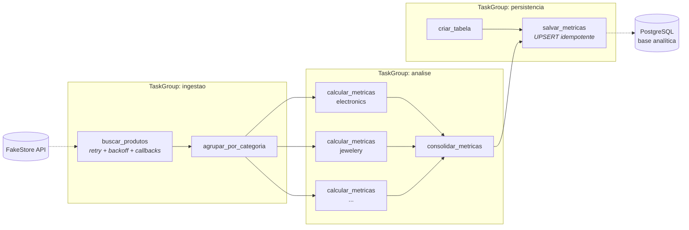

# ShopBrasil · Pipeline de preços por categoria (Apache Airflow)

Pipeline em **Apache Airflow 2.11** que substitui o script Python agendado via cron que alimentava o painel da equipe de pricing da ShopBrasil.

Todo dia às **06:00 (horário de Brasília)** o pipeline:

1. coleta os produtos da API de catálogo ([FakeStore API](https://fakestoreapi.com/docs));
2. calcula, **por categoria**, preço médio, mínimo, máximo e quantidade de produtos;
3. grava o resultado no **PostgreSQL** (base analítica) de forma **idempotente**.

| Problema do script antigo | Como o pipeline resolve |
|---|---|
| API oscila de madrugada e o script falha em silêncio | Retry com backoff exponencial + callbacks de retry, falha (alerta) e sucesso |
| Rodar "na mão" de novo duplica os números | UPSERT por `(data_referencia, categoria)` numa transação: reprocessar não duplica |
| Cada categoria nova exige editar o código | Categorias saem dos dados; o Dynamic Task Mapping cria uma task por categoria |

---

## Arquitetura



| Topologia | Onde |
|---|---|
| **Linear** | `ingestao.buscar_produtos` → `ingestao.agrupar_por_categoria` |
| **Fan-out** | `analise.calcular_metricas.expand(...)`: uma task por categoria |
| **Fan-in** | `analise.consolidar_metricas`: reúne as métricas de todas as categorias |

---

## Como executar

**Pré-requisitos:** Docker com Docker Compose v2 e cerca de 4 GB de RAM livres.

```bash
git clone <url-deste-repositorio>
cd airflow-shopbrasil

# Opcional: em Linux/WSL, use o seu UID para evitar erro de permissão nas pastas
cp .env.example .env
sed -i "s/^AIRFLOW_UID=.*/AIRFLOW_UID=$(id -u)/" .env

docker compose up -d
```

A primeira subida leva alguns minutos (download das imagens e migração do banco). O serviço `airflow-init` prepara tudo sozinho: banco de metadados, usuário da UI, **pool `ecommerce_pool` (2 slots)** e **connection `postgres_analytics`**. Nada precisa ser configurado à mão.

| Serviço | Endereço | Acesso |
|---|---|---|
| Airflow UI | http://localhost:8080 | usuário `airflow` / senha `airflow` |
| PostgreSQL analítico | `localhost:5433`, banco `shopbrasil` | usuário `shopbrasil` / senha `shopbrasil` |

> Credenciais de ambiente local de estudo, configuráveis no `.env`.

Na UI, **despause** o DAG `shopbrasil_precos_por_categoria` (ele já nasce pausado) e clique em **Trigger DAG** para uma execução imediata.

Consultar o resultado:

```bash
docker compose exec postgres-analytics psql -U shopbrasil -d shopbrasil \
  -c "SELECT * FROM metricas_preco_categoria ORDER BY data_referencia, categoria;"
```

Desligar / remover:

```bash
docker compose stop        # para os containers (dados preservados)
docker compose down -v     # remove containers e volumes deste projeto
```

---

## Requisitos obrigatórios → onde estão

| Requisito | Implementação | Arquivo |
|---|---|---|
| TaskFlow API (`@dag` / `@task`), dependências pela chamada das funções | Nenhum `>>` no código; até `criar_tabela → salvar_metricas` sai da passagem do retorno | `dags/shopbrasil_precos_categoria.py` |
| XComs automáticos via `return`, só dados pequenos | `buscar_produtos` devolve apenas `id`, `categoria` e `preco` de cada produto | `dags/shopbrasil/api.py` |
| Topologias linear, fan-out e fan-in | Ver tabela de topologias acima | `dags/shopbrasil_precos_categoria.py` |
| Timezone `America/Sao_Paulo` com pendulum, `start_date`, `catchup=False` | `schedule="0 6 * * *"`, `start_date=pendulum.datetime(..., tz=TIMEZONE)` | `dags/shopbrasil/config.py` |
| Task "Buscar Produtos" com retry e **exponential backoff** | `retries=3`, `retry_delay=20s`, `retry_exponential_backoff=True`, `max_retry_delay=5min` | `dags/shopbrasil/config.py` |
| `try/except` + `raise` para acionar o retry | Timeout, HTTP 4xx/5xx, conexão e resposta inválida tratados e **relançados** | `buscar_produtos` no DAG |
| Callbacks `on_failure`, `on_retry`, `on_success` na task crítica | `alertar_falha`, `notificar_retry`, `registrar_sucesso` | `dags/shopbrasil/callbacks.py` |
| Dynamic Task Mapping (`.expand`) por categoria | `calcular_metricas.expand(lote=...)`; o Grid mostra o nome da categoria (`map_index_template`) | `dags/shopbrasil_precos_categoria.py` |
| Pool `ecommerce_pool` com 2 slots | Criado no `airflow-init`; usado em `calcular_metricas` | `docker-compose.yaml` |
| Pelo menos 2 TaskGroups | 3 grupos: `ingestao`, `analise`, `persistencia` | `dags/shopbrasil_precos_categoria.py` |
| `PostgresHook` + Connection do Airflow | Connection `postgres_analytics`, criada no `airflow-init` | `dags/shopbrasil/db.py` |
| Gravação **idempotente**, sem duplicidade | PK `(data_referencia, categoria)` + `INSERT ... ON CONFLICT DO UPDATE` numa transação | `dags/shopbrasil/db.py` |
| Projeto dockerizado | `docker compose up -d` sobe tudo | `docker-compose.yaml` |

---

## Decisões de projeto

**Data de referência.** A run das 06:00 do dia D cobre o intervalo *(D-1 06:00, D 06:00]*. A data gravada é o **fim do intervalo** (`data_interval_end` em `America/Sao_Paulo`), ou seja, o dia em que o painel é consultado. Reprocessar a mesma run produz a mesma data e o UPSERT sobrescreve.

**Idempotência em uma transação.** `salvar_metricas` faz, atomicamente:
1. UPSERT das categorias da execução;
2. remoção das categorias daquele dia que não vieram mais da API.

O snapshot do dia sempre reflete exatamente o último processamento, e um erro no meio faz rollback: o painel nunca vê um dia gravado pela metade.

**Quem retenta é o Airflow, não o `requests`.** O cliente da API faz uma tentativa por chamada. Assim cada tentativa aparece na UI com log próprio e dispara o callback de retry. HTTP 200 com **lista vazia** também é tratado como erro: gravar "zero produtos" apagaria o panorama do dia.

**Falha não apaga o painel.** Se a API ficar fora do ar e as tentativas se esgotarem, as tasks seguintes ficam `upstream_failed` e a tabela mantém o último snapshot válido.

**Alerta.** `alertar_falha` simula o envio para um canal (`#dados-alertas`) com um log `ERROR` contendo DAG, task, run, número de tentativas, erro e link do log. Ele está na task crítica e, via `default_args`, nas demais, então qualquer falha do pipeline avisa.

**Código modular.** O arquivo do DAG só orquestra. A lógica fica no pacote `dags/shopbrasil/` (ignorado pelo parser via `.airflowignore`), com funções puras de cálculo que podem ser testadas sem Airflow.

---

## Roteiro de demonstração

### 1. Execução normal e escala automática
Dispare o DAG. Em **Graph**, expanda os grupos: `calcular_metricas [4]` mostra uma task por categoria vinda da API, com no máximo 2 rodando ao mesmo tempo (pool). Nenhuma categoria está escrita no código.

### 2. Reprocessamento sem duplicar
Na run concluída, clique em **Clear** (todas as tasks) uma ou mais vezes e rode a consulta abaixo. O total continua igual e `duplicadas = 0`; apenas `run_id`/`atualizado_em` mudam.

```sql
SELECT count(*) AS total,
       count(*) - count(DISTINCT (data_referencia, categoria)) AS duplicadas
FROM metricas_preco_categoria;
```

### 3. API instável → retry, backoff e alerta
A URL da API pode ser sobrescrita pela Airflow Variable opcional `shopbrasil_api_base_url`, sem alterar código.

1. Em **Admin → Variables**, crie `shopbrasil_api_base_url` = `http://api-fora-do-ar.invalid`.
2. Dispare o DAG. Em `buscar_produtos`, os logs de cada tentativa mostram:
   - `[callback] RETRY | ... tentativa 1 de 4 falhou ... proxima tentativa as ...`
   - esperas crescentes entre as tentativas (~40s, ~80s, ~120s);
   - após a 4ª: `ERROR [callback] ALERTA enviado para #dados-alertas (simulado): Pipeline de precos FALHOU ...`
3. **Recuperação:** apague a Variable enquanto a task está em `up_for_retry`. A próxima tentativa conclui com `[callback] SUCESSO ... concluida na tentativa N` e a run termina com sucesso.
4. Apague a Variable ao final do teste.

---

## Estrutura do projeto

```
.
├── docker-compose.yaml          # Airflow (LocalExecutor) + Postgres de metadados + Postgres analítico
├── .env.example                 # variáveis opcionais (UID, portas, credenciais locais)
└── dags/
    ├── shopbrasil_precos_categoria.py   # DAG: só orquestração (tasks, grupos, agendamento)
    ├── .airflowignore                   # não parsear o pacote de apoio como DAG
    └── shopbrasil/
        ├── config.py      # constantes: API, retries, pool, connection, tabela, timezone
        ├── api.py         # cliente da API de catálogo
        ├── callbacks.py   # callbacks de retry, falha (alerta) e sucesso
        ├── metricas.py    # cálculos puros (agrupar e calcular métricas)
        └── db.py          # DDL e gravação idempotente no PostgreSQL
```

## Tabela `metricas_preco_categoria`

| Coluna | Tipo | Descrição |
|---|---|---|
| `data_referencia` | `DATE` (PK) | Dia do panorama (fim do intervalo da run) |
| `categoria` | `TEXT` (PK) | Categoria do produto |
| `preco_medio` / `preco_minimo` / `preco_maximo` | `NUMERIC(12,2)` | Métricas de preço |
| `qtd_produtos` | `INTEGER` | Quantidade de produtos na categoria |
| `run_id` | `TEXT` | Run do Airflow que gravou a linha (auditoria) |
| `atualizado_em` | `TIMESTAMPTZ` | Momento da última gravação |

## Stack

Apache Airflow 2.11.2 (Python 3.12, LocalExecutor) · PostgreSQL 16 · Docker Compose · FakeStore API
